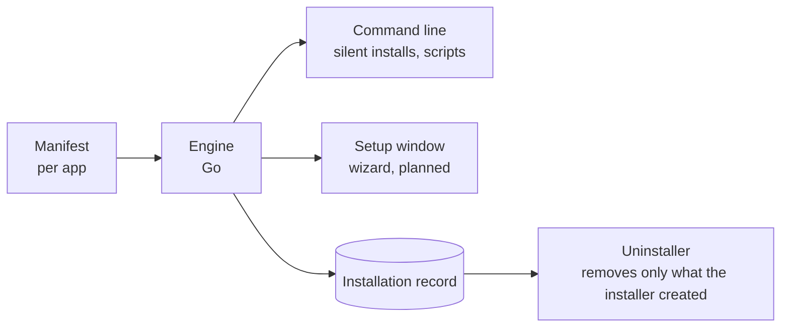

# Stellatinus Installer

A small, shared installer, uninstaller and updater that Stellatinus apps embed in their own download. Each app brings a **manifest** (its name, folders, downloads, shortcuts and one accent colour); the installer gives it a polished setup window, safe checks before anything is written, an uninstaller that only removes what the installer created, and (later) an updater with verification and rollback.

> **Status: early.** The engine can install an app from a manifest and remove it again from the **command line** (checks first, downloads checked against their hash, everything recorded, rollback on failure, and removal only when asked), and a spike shows the setup window's interface. Shortcuts (Start menu and desktop) are made on request and an installation can be repaired. There is **no setup window and no updater yet**, and nothing has been verified on a real Windows, macOS or Linux machine. Follow the work in the [epic](https://github.com/Stellatinus/Stellatinus-Installer/issues/14) and read [docs/decisions.md](docs/decisions.md) for what is decided and what is open.

## What it is, and what it is not

- **It is** one engine that every Stellatinus app (Haedus, Mira, Regulus Desktop, Polaris) packages with its own manifest. Apps stay standalone: you can install one without any other.
- **It is not** a suite installer (like Adobe's or Office's) and not a package manager. Stellatinus tools do not need each other, so a catalogue that installs several of them would add nothing.
- **It is not** for headless servers. Regulus on a server keeps `install.sh`, the `.deb` and systemd; this installer is for desktop apps, such as the future Regulus Desktop.

## How it works



- The **manifest** ([docs/manifest.md](docs/manifest.md)) says what the app is and needs. One accent colour per app; the installer derives readable colours for the light and the dark theme and refuses a colour it cannot make legible.
- The **checks** run before anything is installed: privileges, permission to write in each folder (a test file is really created and deleted, even when run as administrator), free space, folders that overlap, an earlier installation.
- The **installation record** lists every file, folder and shortcut with its owner. Removal follows the record only, never deletes what the user adopted or added (for example AI models that were already on the machine), and never follows a symbolic link out of an install folder.
- The **setup window** is planned as a web UI shown in a system window, following the system's light or dark theme. The interactive draft is in [docs/design/wizard-mockup.html](docs/design/wizard-mockup.html); open it in a browser.

## What exists today

| Part | State |
|---|---|
| Manifest format (folders, components per system, options such as a port, config files, translations), validation, JSON Schema, examples for Haedus, Mira, Polaris and Regulus Desktop | Implemented, unit tested |
| Accent colour derivation with a contrast guarantee (WCAG AA) | Implemented, unit tested |
| Pre-install checks (privileges, write permission, space, overlap, existing install) | Implemented, unit tested; Windows behaviour (ACLs, UAC, controlled folder access) **not verified on a real machine** |
| Installation record, removal plan and a safe `Apply` | Implemented, unit tested; `uninstall --yes` removes by it, `plan` and `uninstall` without `--yes` only **show** it |
| Command line (`validate`, `accent`, `check`, `install`, `uninstall`, `plan`, `pack`, `register`) | Implemented: installs from a manifest with checks first, rolls back on failure or Ctrl+C, a silent mode, a response file and JSON events; `pack` makes a single-file installer and `register` lets an app add what it makes later to the record ([docs/embedding.md](docs/embedding.md)); `uninstall` only shows the plan unless `--yes` ([docs/cli.md](docs/cli.md)). Tested against a local HTTPS server; **not verified on a real machine** |
| Setup window | A **spike and a proposal** ([docs/window.md](docs/window.md)): the local interface server and the choice of browser window are built and tested; the wizard itself is not started ([#5](https://github.com/Stellatinus/Stellatinus-Installer/issues/5)); the choice of technology stays open until real-machine results ([#3](https://github.com/Stellatinus/Stellatinus-Installer/issues/3)) |
| Downloading and installing components (`internal/install`) | Implemented as a library and tested against a local HTTPS server (resume, wrong hash, stalls, hostile zips, rollback); reachable from the command line; nothing verified on a real machine |
| Updater with verification and rollback | Design ([#7](https://github.com/Stellatinus/Stellatinus-Installer/issues/7)) |
| Signing and release trust | Design ([#9](https://github.com/Stellatinus/Stellatinus-Installer/issues/9)) |
| Microsoft Store builds | Postponed ([#8](https://github.com/Stellatinus/Stellatinus-Installer/issues/8)) |
| Linux and macOS | Code compiles and its tests run in CI; behaviour not verified on real machines |

## Try it without building

> **These are unsigned test builds.** Windows SmartScreen and Defender will warn that the publisher is unknown (*More info*, then *Run anyway*); macOS Gatekeeper refuses the file until it is made executable (`chmod +x`) and opened once from the context menu. Nothing in them is verified on a real machine yet, and they will stop being published before a first real release, when signing exists ([#9](https://github.com/Stellatinus/Stellatinus-Installer/issues/9)).

Every push to `main` replaces the files of the [**test-builds** pre-release](https://github.com/Stellatinus/Stellatinus-Installer/releases/tag/test-builds), which needs no GitHub account to download from:

- `Stellatinus-Demo-Setup-<system>-<arch>` for Windows, Linux and macOS (amd64 and arm64): a **fake app** ("Stellatinus Demo") packed into a single-file installer. Double-click it (or run it in a terminal): it lists the folders and the shortcut it will use, asks, installs, and waits for Enter. With options it is the full command line: `Stellatinus-Demo-Setup-linux-amd64 install --shortcut desktop --set models=/some/folder`, `... repair`, `... uninstall --yes stellatinus-demo`.
- `stellatinus-installer-<system>-<arch>`: the plain command line, with no manifest.
- `SHA256SUMS.txt`: the checksum of every file (`sha256sum -c SHA256SUMS.txt`).

The demo downloads a small zip and a larger generated file from the same release, has a folder you can point at an existing one (it is adopted and never removed), a port, English and Italian texts, and the accent colour of the manifest ([`examples/stellatinus-demo.json`](examples/stellatinus-demo.json); `go run ./tools/demo` makes the payload). The setup window will open from the same file when it exists; until then it runs in the console. What to try and what to report back is in the `[Test]` issues.

## Build it yourself

Requires Go 1.26 or newer (the same as Regulus). Use the newest patch release: `govulncheck` finds known standard-library vulnerabilities in older ones, and the installer uses `net/http`, `crypto/tls` and `archive/zip` (Go 1.26.11 or later was clean when this was written).

```sh
git clone https://github.com/Stellatinus/Stellatinus-Installer.git
cd Stellatinus-Installer
make build                                   # builds bin/stellatinus-installer

bin/stellatinus-installer validate examples/haedus.json
bin/stellatinus-installer accent '#f2c200'   # the palette derived from one colour
bin/stellatinus-installer check --set install=/tmp/demo examples/minimal.json
bin/stellatinus-installer install --dry-run --set install=/tmp/demo --set models=/tmp/demo-models examples/haedus.json
```

`check` really creates and removes a test file in the chosen folder but never creates the folder itself.

## Repository layout

| Path | What it holds |
|---|---|
| `cmd/stellatinus-installer` | the command line |
| `internal/manifest` | reading and validating a manifest |
| `internal/theme` | accent colour to readable palettes |
| `internal/checks` | the checks before installing |
| `internal/safepath` | safe names and paths from manifests and archives |
| `internal/install` | downloading, checking, writing and rolling back an installation |
| `internal/localui` | the local interface server for the setup window |
| `internal/opener` | choosing and starting the window or browser |
| `internal/shortcut` | where a shortcut goes per system, and writing it |
| `tools/demo` | makes the payload and manifest of the test installer |
| `spikes/window` | the window spike (not the product) |
| `internal/record` | the installation record and safe removal |
| `schema/` | the manifest's JSON Schema |
| `examples/` | example manifests (the URLs and hashes are fake) |
| `docs/` | architecture, manifest guide, decisions, glossary, design draft |

## Documents

[docs/README.md](docs/README.md) lists everything. Start with [architecture](docs/architecture.md), the [manifest guide](docs/manifest.md) and [decisions](docs/decisions.md).

## Contributing

See [CONTRIBUTING.md](CONTRIBUTING.md). AI coding agents: see [AGENTS.md](AGENTS.md). Report security problems as described in [SECURITY.md](SECURITY.md).

## Licence

[Apache License 2.0](LICENSE).
