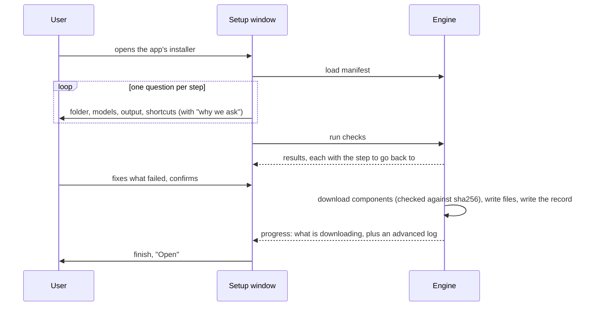

# Architecture

## The idea

One engine, written in Go, packaged inside each app's own download. The app brings a [manifest](manifest.md); the engine does the rest. The engine has two faces: a **command line** (also for silent installs and for Regulus) and a **setup window** (planned).

## The parts

| Package | Job | It does not |
|---|---|---|
| `internal/manifest` | read a manifest strictly (unknown fields are errors), validate it, report all problems together, expand default paths | install anything, touch the disk beyond reading the file |
| `internal/theme` | turn the app's one accent colour into a palette for the light and the dark theme and prove it is legible (WCAG AA, 4.5:1) | draw anything or read the system theme |
| `internal/checks` | privileges, permission to write (by creating and deleting a test file), free space, overlapping folders, an earlier installation; each result says which step to go back to | create folders, keep test files, install |
| `internal/safepath` | check names and relative paths that come from a manifest or an archive, so they are safe on every system | touch the disk |
| `internal/install` | download each component (https only, size capped, resumable, sha256 checked), write it, unpack zips safely, create the shortcuts asked for, record everything, and **roll back** what the run created when something fails | show anything, choose folders or shortcuts, or update an existing installation |
| `internal/shortcut` | work out where a shortcut goes per system and scope, and write it (a `.lnk` by hand, a `.desktop` file, a link), never over an existing file | record anything, pin to the taskbar, or decide which shortcuts the user wants |
| `internal/localui` | serve the setup window's interface on `127.0.0.1`: single-use address, session cookie, Host and Origin checks, security headers | draw the window or decide what the interface does |
| `internal/opener` | choose how to show the address (an app window of Edge, Chrome or Chromium, else the default browser) and start it | serve anything |
| `internal/record` | the installation record (every file, folder and shortcut with its owner), the removal plan, and a safe `Apply` | decide what the user wants to keep; the window passes the choices |
| `cmd/stellatinus-installer` | the command line over the packages above: `install`, `uninstall` (only with `--yes`), `check`, `plan`, `validate`, `accent` | show a window or update an installation |

## What happens at install time (planned)

The engine part, "download components" down to the record, exists as `internal/install` and is tested against a local HTTPS server; it is reachable from the command line (`install`, `uninstall`; see [cli.md](cli.md)). The window does not exist yet.

## Removal

`record.Plan` says what would happen to every entry: **remove** (the installer created it), **keep** (the user chose to), or **protected** (not the installer's: adopted folders and anything added later). `record.Apply` carries it out: files first, then folders from the deepest up; a folder that still holds something not recorded is left. Every path must be inside its recorded location and no folder on the way may be a symbolic link.

## Updates (planned)

A separate process updates direct (non-Store) builds: verify, keep the previous version, swap, health-check, roll back on failure. Design in issue [#7](https://github.com/Stellatinus/Stellatinus-Installer/issues/7); trust model in [#9](https://github.com/Stellatinus/Stellatinus-Installer/issues/9).

## The setup window (planned)

A web UI embedded in the engine, served by `internal/localui` and shown by `internal/opener` in an app window of Edge, Chrome or Chromium (else the default browser); it follows the system's light or dark theme, its text is not selectable (path fields and the advanced log are), and it takes its one accent colour from the manifest. The server and the opener are built and tested; the wizard is not, and whether a webview in a separate program is needed is open ([window.md](window.md), [#3](https://github.com/Stellatinus/Stellatinus-Installer/issues/3), [#29](https://github.com/Stellatinus/Stellatinus-Installer/issues/29)). The draft is in [design/wizard-mockup.html](design/wizard-mockup.html).
